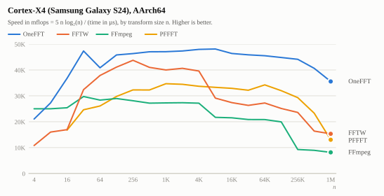
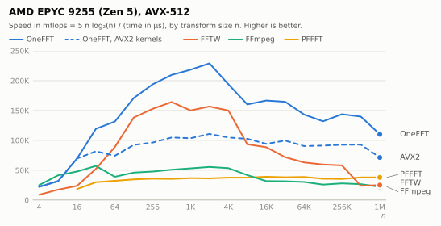
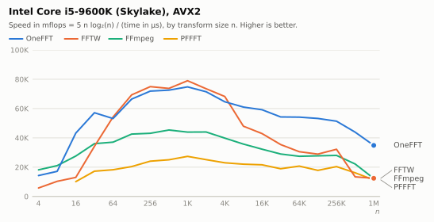
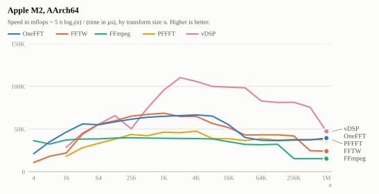

# OneFFT

A simple and fast FFT for power-of-two sizes: complex to complex, single precision, out of place.

* **Fast.** SIMD kernels for AArch64 (Advanced SIMD) and x86-64 (AVX2 with FMA, SSE2). On
  seven machines it is typically 1.3 to 3 times faster than FFmpeg and PFFFT, on par with FFTW's
  patient plans between 64 and 4096 points, and 1.2 to 4 times faster than FFTW above that.
  See [Performance](#performance).
* **Simple to use.** `onefft_forward(in, out, n)`. No planner to run, nothing to tune, and safe
  to call from any number of threads.
* **Simple to ship.** One C file and one header, no dependencies beyond the C library, no
  compiler flags. The instruction set is selected at run time.
* **Simple inside.** A transform is a handful of passes, each of which is one block of inline
  assembly produced and verified by a small generator. [docs/design.md](docs/design.md) explains
  the algorithm in a few pages.

The name: the implementation was one-shot by an AI.

## Usage

Data is interleaved, `re, im, re, im, ...`: n complex values are 2n floats. This is the layout of
`float complex` in C and of `std::complex<float>` in C++. Input and output must not overlap;
they need no particular alignment. Transforms are not normalized: forward followed by inverse
multiplies by n.

```c
#include "onefft.h"

float in[2 * 1024], out[2 * 1024];
/* ... fill in ... */
onefft_forward(in, out, 1024);   /* out[k] = sum_j in[j] exp(-2 pi i jk/n) */
onefft_inverse(out, in, 1024);   /* in is now 1024 times the original */
```

The first call for a size computes the tables for it and keeps them. That takes a few times as
long as the transform itself and allocates memory. Where this must not happen at an arbitrary
time, either prepare the size up front, or manage the tables yourself with a plan:

```c
onefft_cache_prepare(1024, ONEFFT_FORWARD);    /* now onefft_forward(.., 1024) never allocates */

onefft_plan *plan = onefft_plan_create(1024, ONEFFT_FORWARD);   /* computes the tables */
onefft_plan_execute(plan, in, out);                             /* only transforms */
onefft_plan_destroy(plan);
```

Everything is thread safe: one plan can be executed from many threads at once, and so can
`onefft_forward` / `onefft_inverse`, including their first use of a size. The only exception is
`onefft_cache_clear()`, which must not run concurrently with transforms that use the cache.

C++ gets the same through thin inline wrappers in the same header:

```cpp
#include "onefft.h"

std::vector<std::complex<float>> in(1024), out(1024);
onefft::forward(in.data(), out.data(), in.size());

onefft::Plan plan(1024, ONEFFT_FORWARD);   // owns the tables
plan(in.data(), out.data());
```

[include/onefft.h](include/onefft.h) documents every function, including what each call costs.

## Adding it to a project

**Copy two files.** [dist/onefft.c](dist/onefft.c) and [dist/onefft.h](dist/onefft.h) are the
whole library. Compile the C file with your project; link the math library (`-lm`).

**CMake.**

```cmake
add_subdirectory(onefft)            # or FetchContent, or find_package(onefft) after installing
target_link_libraries(app PRIVATE onefft::onefft)
```

**Bazel.** Depend on `@onefft//:onefft`.

Requirements: GCC or Clang (the kernels are inline assembly in their syntax; MSVC's `cl.exe` is
not supported). On targets other than AArch64 and x86-64, and with `-DONEFFT_NO_SIMD`, a portable
C implementation is used; it is correct but several times slower. `-DONEFFT_NO_AVX512` and
`-DONEFFT_NO_AVX2` leave the kernels for these instruction sets out of an x86-64 build.

## Performance

Speed of a forward transform by size, single thread, every library called through its
out-of-place interface on interleaved data. The unit is the one FFT benchmarks commonly use,
"mflops": 5 n log2(n), the operation count of a textbook transform, divided by the time in
microseconds. It makes sizes comparable; higher is better. FFTW 3.3.10 was planned with
`FFTW_PATIENT` up to 4096 points and `FFTW_MEASURE` above; FFmpeg is `av_tx` of version 7.1.

<picture>
  <source media="(prefers-color-scheme: dark)" srcset="docs/plots/s24-dark.svg">
  
</picture>

<picture>
  <source media="(prefers-color-scheme: dark)" srcset="docs/plots/zen5-dark.svg">
  
</picture>

<picture>
  <source media="(prefers-color-scheme: dark)" srcset="docs/plots/intel-dark.svg">
  
</picture>

<picture>
  <source media="(prefers-color-scheme: dark)" srcset="docs/plots/m2-dark.svg">
  
</picture>

[docs/measurements.md](docs/measurements.md) has the charts and the numbers for these and for
an AMD EPYC 9254 (Zen 4), an AMD EPYC 7443P (Zen 3), an AMD Ryzen 7 5700U (Zen 2), a Pixel 3a
(Kryo 360) and a Galaxy A50 (Cortex-A73), and discusses what limits the speed on each of them.
In short:

* Against FFmpeg's `av_tx`, OneFFT is 1.25 to 5.3 times faster from 16 points up (1.13 at
  worst, for large transforms on the M2). Against PFFFT it is 1.2 to 6.3 times faster, except
  for large transforms on the M2, where the two are equal.
* Against FFTW with patient planning it is 1.3 to 3.6 times faster up to 32 points, and 1.2 to
  5.9 times faster from 8192 points up. From 64 to 4096 points the two are close with NEON and
  AVX2: between 14% slower and 21% faster, depending on the machine and the size. The M2 is the
  exception at the top: there FFTW is up to 16% faster between 2^15 and 2^18 points.
* With AVX-512 it is ahead of FFTW at every size on the two machines measured, Zen 4 and
  Zen 5: by 1.05 to 1.5 times from 64 to 4096 points. Its AVX-512 kernels are 1.45 to 2.1 times
  faster than its AVX2 kernels on Zen 5, and 1.1 to 1.27 times on Zen 4.
* On Apple hardware, Apple's own vDSP is 1.2 to 2.4 times faster than OneFFT from 512 points up
  (it works on separate real and imaginary arrays and is written for exactly these cores).

Reproduce with `scripts/third_party.sh <target>` (fetches and builds the other libraries) and
`scripts/build_bench.sh <target>`. The measured times are in [docs/results](docs/results);
`scripts/update_docs.py` turns them into the tables and charts.

## Limits

* Power-of-two sizes only, single precision only, complex data only.
* Out of place only: `in` and `out` must not overlap.
* The AVX-512 kernels were tuned on AMD's Zen 4 and Zen 5. On Intel processors they have only
  run under an emulator: nothing is known about their speed there (`-DONEFFT_NO_AVX512` leaves
  them out). The SSE2 kernels (for x86-64 processors without AVX2) are complete but were not
  tuned either.
* Tested on Linux, Android and macOS. Windows with MinGW or Clang should work but is untested.

## Development

```
gen/            the kernel generator (Python, no dependencies) and its simulation tests
src/            the runtime, onefft.c, and the generated kernels, onefft_*.inc
include/        the public header
dist/           the single file distribution, generated
tests/          tests of the built library
bench/          benchmark against other libraries, and tools used for tuning
scripts/        build, test and benchmark helpers for the host, Android devices and a Mac
docs/           design and measurements
reference/      the 2021 proof of concept that OneFFT started from
```

After changing a kernel:

```
python3 gen/test_kernels.py      # runs every kernel in simulation against a reference FFT
python3 gen/generate.py          # rewrites src/onefft_*.inc and dist/
scripts/test.sh host             # builds with warnings as errors, tests every code path
```

`scripts/test.sh <device>` runs the tests on an Android device over adb and
`scripts/remote.sh <machine> test` on another machine over ssh. CI runs all of the above on
x86-64 and AArch64, with GCC and Clang, on Linux and macOS.

`bench/passes.c` times the passes of a transform separately, and `bench/uops_aarch64.c` and
`bench/uops_x86.c` measure what a core does with the instructions the kernels are made of.
[docs/measurements.md](docs/measurements.md) explains how they were used.
