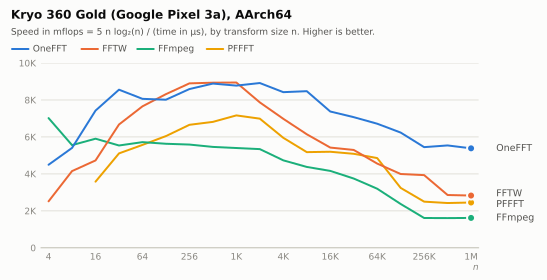
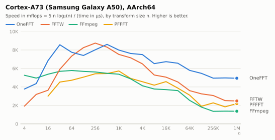
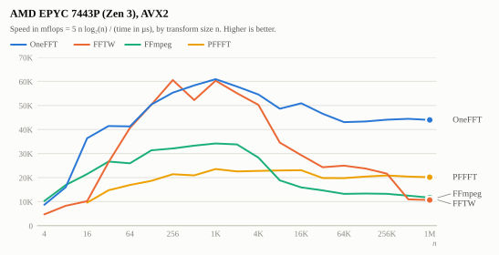
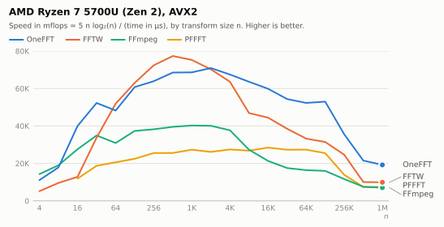

# OneFFT measurements

What was measured while building OneFFT, and what followed from it. [design.md](design.md)
describes the result; this document is the evidence behind its decisions, and the place to look
before trying to make something faster.

## Setup

| machine | core | instruction set |
|---|---|---|
| Google Pixel 3a | Kryo 360 Gold (Cortex-A75 derivative), 2.0 GHz | AArch64 |
| Samsung Galaxy A50 | Cortex-A73, 2.3 GHz | AArch64 |
| Samsung Galaxy S24 | Cortex-X4, 3.2 GHz | AArch64 |
| Apple M2 | Avalanche, 3.5 GHz | AArch64 |
| Laptop | AMD Ryzen 7 5700U (Zen 2), 4.3 GHz | AVX2 |
| Desktop | Intel Core i5-9600K (Skylake), 4.5 GHz | AVX2 |
| Server | AMD EPYC 7443P (Zen 3) | AVX2 |

All times are for one forward transform, single thread, pinned to the fastest cores on the
phones, minimum over 15 samples of at least 5 ms each (`bench/bench.c`). Every library is called
through its out-of-place interface on interleaved data, except vDSP, which only has split real
and imaginary arrays and is given those (the conversion is not timed, which favours it).

* FFTW 3.3.10, single precision, NEON or AVX2 enabled, `FFTW_PATIENT` plans up to 4096 points
  and `FFTW_MEASURE` above (patient planning of large sizes takes minutes).
* FFmpeg 7.1, `av_tx` with `AV_TX_FLOAT_FFT`, with its assembly for the target.
* PFFFT (the marton78 fork), `pffft_transform_ordered`; SSE or NEON, it has no AVX kernels.
* vDSP from Accelerate, `vDSP_DFT_Execute`.

`scripts/third_party.sh` builds the libraries and `scripts/build_bench.sh` the benchmark.
Compilers: Clang 18 (Android NDK r27c), Apple Clang 21, GCC 15.

## Results

The charts show speed in "mflops": 5 n log2(n), the operation count of a textbook radix 2
transform of n points, divided by the time in microseconds. In this unit a library whose cost
per operation does not depend on the size draws a horizontal line, and the drop of every curve
towards the right is the transform outgrowing the caches. The tables under each chart have the
times in nanoseconds; their columns on the right are the time of the other library divided by
the time of OneFFT.

### Cortex-X4 (Galaxy S24)

<picture>
  <source media="(prefers-color-scheme: dark)" srcset="plots/s24-dark.svg">
  
</picture>

Times in nanoseconds

<!-- results:s24 -->
| n | OneFFT | FFTW | FFmpeg | PFFFT | vs FFTW | vs FFmpeg | vs PFFFT |
|--:|--:|--:|--:|--:|--:|--:|--:|
| 2 | 1.1 | 3.1 | 0.9 | - | 2.82 | 0.82 | - |
| 4 | 1.9 | 3.7 | 1.6 | - | 1.95 | 0.84 | - |
| 8 | 4.4 | 7.5 | 4.8 | - | 1.70 | 1.09 | - |
| 16 | 8.7 | 18.9 | 12.6 | 19.1 | 2.17 | 1.45 | 2.20 |
| 32 | 16.9 | 24.7 | 26.9 | 32.5 | 1.46 | 1.59 | 1.92 |
| 64 | 47.0 | 50.7 | 67.7 | 73.6 | 1.08 | 1.44 | 1.57 |
| 128 | 97.8 | 109.0 | 154.7 | 150.5 | 1.11 | 1.58 | 1.54 |
| 256 | 221.0 | 234.1 | 364.3 | 317.1 | 1.06 | 1.65 | 1.43 |
| 512 | 489.9 | 561.9 | 847.8 | 714.1 | 1.15 | 1.73 | 1.46 |
| 1024 | 1088 | 1280 | 1877 | 1476 | 1.18 | 1.73 | 1.36 |
| 2048 | 2379 | 2772 | 4120 | 3269 | 1.16 | 1.73 | 1.37 |
| 4096 | 5125 | 6207 | 9047 | 7292 | 1.21 | 1.77 | 1.42 |
| 8192 | 11069 | 18286 | 24546 | 15996 | 1.65 | 2.22 | 1.45 |
| 16384 | 24730 | 41888 | 53323 | 34860 | 1.69 | 2.16 | 1.41 |
| 32768 | 53596 | 93390 | 117887 | 76394 | 1.74 | 2.20 | 1.43 |
| 65536 | 115218 | 192529 | 251765 | 153120 | 1.67 | 2.19 | 1.33 |
| 131072 | 248550 | 443613 | 558852 | 348188 | 1.78 | 2.25 | 1.40 |
| 262144 | 534678 | 1000225 | 2548672 | 804922 | 1.87 | 4.77 | 1.51 |
| 524288 | 1225722 | 3041602 | 5570117 | 2138848 | 2.48 | 4.54 | 1.74 |
| 1048576 | 2949024 | 6842500 | 12856132 | 8048164 | 2.32 | 4.36 | 2.73 |
<!-- end -->

### Kryo 360 Gold (Pixel 3a)

<picture>
  <source media="(prefers-color-scheme: dark)" srcset="plots/pixel3a-dark.svg">
  
</picture>

Times in nanoseconds

<!-- results:pixel3a -->
| n | OneFFT | FFTW | FFmpeg | PFFFT | vs FFTW | vs FFmpeg | vs PFFFT |
|--:|--:|--:|--:|--:|--:|--:|--:|
| 2 | 4.0 | 11.5 | 4.0 | - | 2.88 | 1.00 | - |
| 4 | 8.6 | 15.9 | 5.6 | - | 1.85 | 0.65 | - |
| 8 | 22.2 | 28.9 | 21.5 | - | 1.30 | 0.97 | - |
| 16 | 42.3 | 67.5 | 54.2 | 88.7 | 1.60 | 1.28 | 2.10 |
| 32 | 93.5 | 120.0 | 143.9 | 157.1 | 1.28 | 1.54 | 1.68 |
| 64 | 237.7 | 251.0 | 336.0 | 342.7 | 1.06 | 1.41 | 1.44 |
| 128 | 559.1 | 538.7 | 794.5 | 737.1 | 0.96 | 1.42 | 1.32 |
| 256 | 1196 | 1152 | 1833 | 1565 | 0.96 | 1.53 | 1.31 |
| 512 | 2591 | 2578 | 4208 | 3391 | 1.00 | 1.62 | 1.31 |
| 1024 | 5847 | 5742 | 9463 | 7152 | 0.98 | 1.62 | 1.22 |
| 2048 | 12633 | 14476 | 21033 | 16174 | 1.15 | 1.66 | 1.28 |
| 4096 | 29110 | 34785 | 51160 | 40749 | 1.19 | 1.76 | 1.40 |
| 8192 | 63061 | 86929 | 121626 | 102456 | 1.38 | 1.93 | 1.62 |
| 16384 | 155583 | 203591 | 275980 | 235306 | 1.31 | 1.77 | 1.51 |
| 32768 | 346634 | 461823 | 656719 | 513770 | 1.33 | 1.89 | 1.48 |
| 65536 | 813151 | 1130234 | 1572760 | 1113763 | 1.39 | 1.93 | 1.37 |
| 131072 | 1788724 | 2811303 | 4643125 | 3447292 | 1.57 | 2.60 | 1.93 |
| 262144 | 4403855 | 6090366 | 14824376 | 9449792 | 1.38 | 3.37 | 2.15 |
| 524288 | 8826928 | 17496824 | 31115524 | 20413023 | 1.98 | 3.53 | 2.31 |
| 1048576 | 19808283 | 37532399 | 64856048 | 42985056 | 1.89 | 3.27 | 2.17 |
<!-- end -->

### Cortex-A73 (Galaxy A50)

<picture>
  <source media="(prefers-color-scheme: dark)" srcset="plots/a50-dark.svg">
  
</picture>

Times in nanoseconds

<!-- results:a50 -->
| n | OneFFT | FFTW | FFmpeg | PFFFT | vs FFTW | vs FFmpeg | vs PFFFT |
|--:|--:|--:|--:|--:|--:|--:|--:|
| 2 | 5.0 | 15.3 | 4.9 | - | 3.06 | 0.98 | - |
| 4 | 10.6 | 20.8 | 7.6 | - | 1.96 | 0.72 | - |
| 8 | 27.5 | 37.6 | 24.1 | - | 1.37 | 0.88 | - |
| 16 | 47.1 | 89.1 | 59.2 | 104.6 | 1.89 | 1.26 | 2.22 |
| 32 | 95.2 | 135.0 | 140.3 | 175.1 | 1.42 | 1.47 | 1.84 |
| 64 | 247.1 | 261.1 | 333.1 | 402.1 | 1.06 | 1.35 | 1.63 |
| 128 | 604.8 | 544.9 | 790.5 | 884.2 | 0.90 | 1.31 | 1.46 |
| 256 | 1277 | 1174 | 1824 | 1894 | 0.92 | 1.43 | 1.48 |
| 512 | 2677 | 2779 | 4221 | 4216 | 1.04 | 1.58 | 1.57 |
| 1024 | 6408 | 6809 | 9552 | 8930 | 1.06 | 1.49 | 1.39 |
| 2048 | 14670 | 15752 | 23146 | 22690 | 1.07 | 1.58 | 1.55 |
| 4096 | 32741 | 37842 | 59062 | 53994 | 1.16 | 1.80 | 1.65 |
| 8192 | 81653 | 100835 | 140945 | 126844 | 1.23 | 1.73 | 1.55 |
| 16384 | 170394 | 227445 | 311411 | 254584 | 1.33 | 1.83 | 1.49 |
| 32768 | 378514 | 541486 | 696827 | 625337 | 1.43 | 1.84 | 1.65 |
| 65536 | 905317 | 1427673 | 2027846 | 1720788 | 1.58 | 2.24 | 1.90 |
| 131072 | 2043077 | 3168885 | 6200731 | 5690730 | 1.55 | 3.03 | 2.79 |
| 262144 | 4749154 | 7479308 | 17297346 | 10778423 | 1.57 | 3.64 | 2.27 |
| 524288 | 10035039 | 19788077 | 36264270 | 25622923 | 1.97 | 3.61 | 2.55 |
| 1048576 | 21079576 | 42665307 | 76883846 | 48047923 | 2.02 | 3.65 | 2.28 |
<!-- end -->

### Apple M2

<picture>
  <source media="(prefers-color-scheme: dark)" srcset="plots/m2-dark.svg">
  
</picture>

Times in nanoseconds

<!-- results:m2 -->
| n | OneFFT | FFTW | FFmpeg | PFFFT | vDSP | vs FFTW | vs FFmpeg | vs PFFFT | vs vDSP |
|--:|--:|--:|--:|--:|--:|--:|--:|--:|--:|
| 2 | 1.6 | 2.6 | 1.1 | - | - | 1.62 | 0.69 | - | - |
| 4 | 1.9 | 3.7 | 1.1 | - | - | 1.95 | 0.58 | - | - |
| 8 | 3.4 | 6.6 | 3.7 | - | - | 1.94 | 1.09 | - | - |
| 16 | 6.9 | 14.6 | 8.6 | 17.7 | 11.2 | 2.12 | 1.25 | 2.57 | 1.62 |
| 32 | 14.3 | 18.2 | 20.9 | 28.5 | 17.7 | 1.27 | 1.46 | 1.99 | 1.24 |
| 64 | 34.9 | 34.5 | 50.0 | 57.7 | 34.5 | 0.99 | 1.43 | 1.65 | 0.99 |
| 128 | 76.7 | 75.2 | 113.7 | 117.4 | 68.2 | 0.98 | 1.48 | 1.53 | 0.89 |
| 256 | 166.6 | 157.3 | 257.3 | 234.8 | 203.7 | 0.94 | 1.54 | 1.41 | 1.22 |
| 512 | 361.3 | 343.3 | 585.3 | 546.4 | 308.5 | 0.95 | 1.62 | 1.51 | 0.85 |
| 1024 | 789.3 | 747.3 | 1307 | 1105 | 535.6 | 0.95 | 1.66 | 1.40 | 0.68 |
| 2048 | 1714 | 1741 | 2890 | 2465 | 1022 | 1.02 | 1.69 | 1.44 | 0.60 |
| 4096 | 3693 | 3791 | 6330 | 5172 | 2324 | 1.03 | 1.71 | 1.40 | 0.63 |
| 8192 | 8176 | 9432 | 13891 | 13730 | 5332 | 1.15 | 1.70 | 1.68 | 0.65 |
| 16384 | 20891 | 22211 | 32617 | 29727 | 11578 | 1.06 | 1.56 | 1.42 | 0.55 |
| 32768 | 61312 | 57141 | 76906 | 67219 | 25023 | 0.93 | 1.25 | 1.10 | 0.41 |
| 65536 | 142562 | 121406 | 166000 | 135812 | 63297 | 0.85 | 1.16 | 0.95 | 0.44 |
| 131072 | 306125 | 257938 | 346625 | 300938 | 137312 | 0.84 | 1.13 | 0.98 | 0.45 |
| 262144 | 637500 | 563375 | 1536000 | 623750 | 290250 | 0.88 | 2.41 | 0.98 | 0.46 |
| 524288 | 1337500 | 2025500 | 3236000 | 1317500 | 660000 | 1.51 | 2.42 | 0.99 | 0.49 |
| 1048576 | 2661000 | 4363000 | 6847000 | 2806000 | 2216000 | 1.64 | 2.57 | 1.05 | 0.83 |
<!-- end -->

### Intel Core i5-9600K (Skylake), AVX2

<picture>
  <source media="(prefers-color-scheme: dark)" srcset="plots/intel-dark.svg">
  
</picture>

Times in nanoseconds

<!-- results:intel -->
| n | OneFFT | FFTW | FFmpeg | PFFFT | vs FFTW | vs FFmpeg | vs PFFFT |
|--:|--:|--:|--:|--:|--:|--:|--:|
| 2 | 2.0 | 6.0 | 1.8 | - | 3.00 | 0.90 | - |
| 4 | 2.8 | 6.5 | 2.4 | - | 2.32 | 0.86 | - |
| 8 | 7.3 | 12.0 | 5.7 | - | 1.64 | 0.78 | - |
| 16 | 7.4 | 24.1 | 11.6 | 33.7 | 3.26 | 1.57 | 4.55 |
| 32 | 14.0 | 21.9 | 21.5 | 46.4 | 1.56 | 1.54 | 3.31 |
| 64 | 39.5 | 41.2 | 52.9 | 109.0 | 1.04 | 1.34 | 2.76 |
| 128 | 70.4 | 67.7 | 106.2 | 215.1 | 0.96 | 1.51 | 3.06 |
| 256 | 145.4 | 136.3 | 240.6 | 417.1 | 0.94 | 1.65 | 2.87 |
| 512 | 328.0 | 291.7 | 511.5 | 920.8 | 0.89 | 1.56 | 2.81 |
| 1024 | 683.9 | 664.7 | 1138 | 1927 | 0.97 | 1.66 | 2.82 |
| 2048 | 1595 | 1551 | 2695 | 4687 | 0.97 | 1.69 | 2.94 |
| 4096 | 4353 | 3990 | 6333 | 11274 | 0.92 | 1.45 | 2.59 |
| 8192 | 8824 | 11371 | 16068 | 25441 | 1.29 | 1.82 | 2.88 |
| 16384 | 19583 | 26499 | 35949 | 54309 | 1.35 | 1.84 | 2.77 |
| 32768 | 44906 | 67506 | 84453 | 125816 | 1.50 | 1.88 | 2.80 |
| 65536 | 96871 | 177583 | 190030 | 261951 | 1.83 | 1.96 | 2.70 |
| 131072 | 211784 | 353387 | 398592 | 566408 | 1.67 | 1.88 | 2.67 |
| 262144 | 456699 | 724082 | 840236 | 1218783 | 1.59 | 1.84 | 2.67 |
| 524288 | 1139242 | 3731023 | 2148882 | 3134970 | 3.28 | 1.89 | 2.75 |
| 1048576 | 2919645 | 8346325 | 8577686 | 9414169 | 2.86 | 2.94 | 3.22 |
<!-- end -->

### AMD EPYC 7443P (Zen 3), AVX2

<picture>
  <source media="(prefers-color-scheme: dark)" srcset="plots/epyc-dark.svg">
  
</picture>

Times in nanoseconds

<!-- results:epyc -->
| n | OneFFT | FFTW | FFmpeg | PFFFT | vs FFTW | vs FFmpeg | vs PFFFT |
|--:|--:|--:|--:|--:|--:|--:|--:|
| 2 | 3.4 | 7.4 | 2.1 | - | 2.18 | 0.62 | - |
| 4 | 4.6 | 8.5 | 3.9 | - | 1.85 | 0.85 | - |
| 8 | 7.5 | 14.5 | 7.1 | - | 1.93 | 0.95 | - |
| 16 | 8.8 | 31.4 | 14.9 | 33.4 | 3.57 | 1.69 | 3.80 |
| 32 | 19.3 | 30.3 | 30.0 | 54.3 | 1.57 | 1.55 | 2.81 |
| 64 | 46.5 | 47.2 | 74.0 | 113.4 | 1.02 | 1.59 | 2.44 |
| 128 | 88.9 | 89.0 | 142.9 | 240.2 | 1.00 | 1.61 | 2.70 |
| 256 | 185.1 | 169.1 | 318.8 | 478.5 | 0.91 | 1.72 | 2.59 |
| 512 | 394.9 | 441.0 | 692.2 | 1101 | 1.12 | 1.75 | 2.79 |
| 1024 | 840.3 | 849.0 | 1498 | 2174 | 1.01 | 1.78 | 2.59 |
| 2048 | 1947 | 2045 | 3334 | 4992 | 1.05 | 1.71 | 2.56 |
| 4096 | 4505 | 4892 | 8685 | 10788 | 1.09 | 1.93 | 2.39 |
| 8192 | 10946 | 15419 | 28277 | 23188 | 1.41 | 2.58 | 2.12 |
| 16384 | 22531 | 39125 | 72073 | 49746 | 1.74 | 3.20 | 2.21 |
| 32768 | 52796 | 101118 | 167429 | 124081 | 1.92 | 3.17 | 2.35 |
| 65536 | 121752 | 209993 | 396611 | 265136 | 1.72 | 3.26 | 2.18 |
| 131072 | 257086 | 468810 | 833370 | 545456 | 1.82 | 3.24 | 2.12 |
| 262144 | 535243 | 1090049 | 1781685 | 1129582 | 2.04 | 3.33 | 2.11 |
| 524288 | 1120759 | 4546586 | 3991483 | 2439349 | 4.06 | 3.56 | 2.18 |
| 1048576 | 2383984 | 9825527 | 8988031 | 5199750 | 4.12 | 3.77 | 2.18 |
<!-- end -->

### AMD Ryzen 7 5700U (Zen 2), AVX2

<picture>
  <source media="(prefers-color-scheme: dark)" srcset="plots/zen2-dark.svg">
  
</picture>

Times in nanoseconds

<!-- results:zen2 -->
| n | OneFFT | FFTW | FFmpeg | PFFFT | vs FFTW | vs FFmpeg | vs PFFFT |
|--:|--:|--:|--:|--:|--:|--:|--:|
| 2 | 1.8 | 6.5 | 1.8 | - | 3.61 | 1.00 | - |
| 4 | 3.6 | 7.7 | 2.8 | - | 2.14 | 0.78 | - |
| 8 | 6.7 | 12.5 | 6.3 | - | 1.87 | 0.94 | - |
| 16 | 8.0 | 24.9 | 11.6 | 26.9 | 3.11 | 1.45 | 3.36 |
| 32 | 15.3 | 23.7 | 22.9 | 42.7 | 1.55 | 1.50 | 2.79 |
| 64 | 39.8 | 37.0 | 62.1 | 93.1 | 0.93 | 1.56 | 2.34 |
| 128 | 73.7 | 71.1 | 119.9 | 199.2 | 0.96 | 1.63 | 2.70 |
| 256 | 160.2 | 141.4 | 267.8 | 400.5 | 0.88 | 1.67 | 2.50 |
| 512 | 336.2 | 297.8 | 582.7 | 900.8 | 0.89 | 1.73 | 2.68 |
| 1024 | 746.0 | 680.3 | 1272 | 1873 | 0.91 | 1.70 | 2.51 |
| 2048 | 1588 | 1604 | 2809 | 4307 | 1.01 | 1.77 | 2.71 |
| 4096 | 3643 | 3863 | 6518 | 8946 | 1.06 | 1.79 | 2.46 |
| 8192 | 8372 | 11358 | 19485 | 19853 | 1.36 | 2.33 | 2.37 |
| 16384 | 19155 | 25798 | 53730 | 40297 | 1.35 | 2.81 | 2.10 |
| 32768 | 45195 | 63824 | 140184 | 89924 | 1.41 | 3.10 | 1.99 |
| 65536 | 100217 | 157656 | 319324 | 191534 | 1.57 | 3.19 | 1.91 |
| 131072 | 210283 | 354244 | 695371 | 437177 | 1.68 | 3.31 | 2.08 |
| 262144 | 664179 | 958076 | 2027876 | 1695287 | 1.44 | 3.05 | 2.55 |
| 524288 | 2314376 | 4944622 | 6598050 | 6744829 | 2.14 | 2.85 | 2.91 |
| 1048576 | 5453541 | 10560793 | 14855047 | 14103937 | 1.94 | 2.72 | 2.59 |
<!-- end -->

### SSE2

The SSE2 kernels on the i5-9600K (built with `-DONEFFT_NO_AVX2`) against PFFFT, which is also
SSE. They were not tuned.

<!-- results:intel_sse2 -->
| n | OneFFT | PFFFT | vs PFFFT |
|--:|--:|--:|--:|
| 8 | 7.2 | - | - |
| 16 | 13.3 | 34.2 | 2.57 |
| 32 | 41.3 | 46.1 | 1.12 |
| 64 | 80.0 | 105.1 | 1.31 |
| 128 | 194.6 | 217.5 | 1.12 |
| 256 | 390.8 | 425.4 | 1.09 |
| 512 | 920.3 | 944.7 | 1.03 |
| 1024 | 1889 | 1927 | 1.02 |
| 2048 | 4426 | 4589 | 1.04 |
| 4096 | 9836 | 10823 | 1.10 |
| 8192 | 22466 | 24931 | 1.11 |
| 16384 | 46670 | 54980 | 1.18 |
| 32768 | 106882 | 127050 | 1.19 |
| 65536 | 216638 | 258271 | 1.19 |
<!-- end -->

### Summary

* Against FFmpeg, OneFFT is 1.25 to 4.8 times faster from 16 points up, on every machine (1.13
  at worst, for large transforms on the M2). Against PFFFT 1.2 to 4.5 times, except for large
  transforms on the M2, where the two are equal. At 4 and 8 points FFmpeg's dedicated kernels
  are up to 1.3 times faster than OneFFT's.
* Against patient FFTW there are three ranges. Up to 32 points OneFFT's single kernels are 1.3 to
  3.6 times faster. From 8192 points up OneFFT is 1.2 to 4 times faster: its passes stay cache
  friendly, and FFTW's measured (not patient) plans are weaker. Between 64 and 4096 points both
  are close, OneFFT being between 12% slower and 21% faster (ahead at every size on the
  Cortex-X4, behind at most on Zen 2); FFTW's patient planner picks large generated codelets
  there that need very few passes.
* The M2 is different at the top: between 2^15 and 2^18 points FFTW is up to 16% faster there,
  and PFFFT is as fast as OneFFT. This was not investigated.
* Apple's vDSP is in a class of its own on the M2: 1.2 to 2.4 times faster than OneFFT from 512
  points up, and faster than FFTW. It is the only other library here that is written for one
  specific family of cores, and the only one that does not have to split and interleave.
* The 2021 proof of concept in `reference/` takes 6.9 us for 1024 points on the Pixel 3a, 6.6 us
  on the A50, 2.1 us on the S24 and 1.5 us on the M2: 1.04 to 1.9 times the time of OneFFT.

## What the cores can do

`bench/uops_aarch64.c` and `bench/uops_x86.c` run loops of independent instructions of one kind.
The numbers explain most of what the pass timings (`bench/passes.c`) show.

### AArch64: cycles per instruction

| | Kryo 360 | Cortex-A73 | Cortex-X4 | Apple M2 |
|---|--:|--:|--:|--:|
| `fadd`, `fmul`, `fmla`, 4 lanes | 0.9 | 0.9 | 0.25 | 0.25 |
| the same with 2 lanes or scalar | 0.37 | 0.47 | 0.25 | 0.25 |
| `trn`, `zip`, `uzp` | 0.55 | 0.6 | 0.25 | 0.25 |
| `mov` between vector registers | 0.55 | 0.6 | 0.25 | 0.1 (free) |
| `ldr q` | 0.9 | 1.0 | 0.27 | 0.29 |
| `ldp q, q` | 2.2 | 2.0 | 0.60 | 0.65 |
| `ld2` (4 lanes) | 2.2 | 2.6 | 0.93 | 0.94 |
| `str q` | 0.9 | 1.9 | 0.44 | 0.44 |
| `stp q, q` | 1.9 | 4.0 | 0.93 | 0.94 |
| `st2` (4 lanes) | 1.9 | 4.2 | 0.93 | 0.94 |
| `ld2` of one lane | 0.9 | 0.9 | 0.93 | 0.45 |

What follows:

* **The older cores execute one 128 bit floating point operation per cycle**, half the rate of
  their 64 bit operations: their SIMD units are 64 bits wide. A load or store of a register
  costs about as much as an arithmetic operation. On these cores the time of a kernel is close
  to the number of 128 bit operations it executes, counting loads and stores. A 1024 point
  transform is about 8200 arithmetic operations and 1000 shuffles in OneFFT; the two codelets of
  FFTW's plan (two radix 32 passes) come to about 7800 and 2000, counted in their disassembly.
  That is why the two are equal there, and why reordering the same arithmetic does not help.
* **The current cores execute four operations per cycle**, and OneFFT's passes reach 3 to 3.4.
  Loads are nearly free, stores are limited to two registers per cycle.
* **Loading one lane costs as much as loading a whole register** everywhere but on Apple. The
  proof of concept gathers its 32 values lane by lane; that is 4 times the load and store
  instructions per pass and the reason for the different structure of OneFFT.
* `ld2` and `st2` are no bargain: they run at one per cycle on the fast cores. `ldp` with two
  `uzp` is equally fast or faster.
* A `mov` is free only on Apple. This decides whether butterflies made from fused multiply-adds
  (6 operations and 3 copies instead of 8 operations) pay off. Measured on the M2: 876 to
  798 ns at 1024 points.
* On the Cortex-X4, registers that hold subnormal numbers or NaNs make arithmetic 2.3 times
  slower. Benchmarks must not run on uninitialised registers or on data that has decayed to
  subnormals.

### x86-64: 256 bit instructions per cycle

| | Skylake | Zen 2 | Zen 3 |
|---|--:|--:|--:|
| loads | 2 | 2 | 2 |
| stores | 1 | 1 | 1 |
| additions | 2 | 2 | 2 |
| multiplications, fused multiply-adds | 2 | 2 | 2 |
| additions and multiplications together | 2 | 4 | 4 |
| `unpck`, `shufps` | 1 | 2 | 2 |
| `vperm2f128`, `vinsertf128` between registers | 1 | 1 | 1 |

What follows:

* **One store per cycle** on all three. A radix 4 pass over 32 values is 8 stores, as long as
  its arithmetic takes on a good day. Fewer passes matter more than on AArch64, hence the two
  radix 8 kernels that work in place (design.md).
* **Skylake** shares two units between additions and multiplications and has one for shuffles.
  Its pipeline is 4 instructions wide, and the kernels run close to that limit as well: the
  instruction count matters, and memory operands (a load fused with the operation) are worth
  using everywhere.
* **Zen** has separate units for additions and multiplications. Standard butterflies use both
  evenly. The in-place kernels lean on fused multiply-adds and are limited by those units; the
  radix 8 pass before the last gained 6 to 10% at even sizes on Skylake and nothing on Zen 3.
  On Zen 2, stores additionally occupy one of the two addition units.
* Moving the 128 bit halves of registers around is slow everywhere. `lb` does it while loading.

## Decisions and their effect

Times in ns for 1024 points unless stated.

| change | effect |
|---|---|
| OneFFT instead of the proof of concept (AArch64) | Pixel 3a 6860 to 5850, A50 6640 to 6410, S24 2060 to 1090, M2 1460 to 790 |
| Instruction scheduling and 2x unrolling in the generator (AArch64) | Pixel 3a 6380 to 5650, A50 7110 to 6040, S24 1030 to 1010, M2 870 to 815 |
| Fused multiply-add form of the passes | M2 876 to 798; not used elsewhere |
| Cache blocking of the middle passes, 2^21 points | Pixel 3a 52.5 ms to 42.8 ms, A50 56.5 to 47.2, S24 unchanged |
| Region loops inside the kernels instead of one call per region (AVX2) | Skylake 834 to 717, Zen 3 906 to 841; 256 points on Skylake 166 to 152 |
| Radix 8 first pass (AVX2, odd number of index bits), 512 points | Skylake 369 to 319, Zen 3 426 to 385 |
| Radix 8 pass before the last (AVX2, even number of index bits) | Skylake 745 to 680, Zen 3 unchanged, Zen 2 767 to 749 |

Tried and dropped:

* **First pass reading with a stride** so that consecutive butterflies write next to each other
  instead of to bit reversed positions: 2^21 points on the Pixel 3a took 64 ms instead of 43 ms.
* **Prefetching the scattered output lines of the first pass:** 3% faster on the Pixel 3a at
  2^21 points, 4 to 10% slower on the S24.
* **`ldr`/`str` instead of `ldp`/`stp`:** `ldp` looks very slow in isolation on the Kryo
  (table above), but in the kernels the pair forms are equal or better on every core.
* **A radix 4 last pass where possible** (it has fewer twiddle multiplications): slower. Per
  index bit the radix 8 last pass is cheaper because the transposition and the interleaving
  are paid once for three bits instead of two.
* **Butterfly differences by fused multiply-add** (`a - b = (a + b) - 2b`) in the standard AVX2
  kernels, to move work from the adders to the multipliers on Zen: no gain on Zen 2.
* **Scheduling and unrolling on x86:** no measurable effect.

## Where the time goes

Cycles per butterfly (one kernel iteration, 32 values) at 1024 points, from `bench/passes.c`:

| | first | middle | last |
|---|--:|--:|--:|
| Kryo 360, radix 8 / 4 / 8 | 75 | 40 per radix 4 | 150 |
| Cortex-X4, radix 8 / 4 / 8 | 22 | 10 per radix 4 | 47 |
| Apple M2 (fused), radix 8 / 4 / 8 | 19 | 8 per radix 4 | 35 |

The radix 8 kernels execute 56 (first), 84 (middle) and 120 (last) arithmetic and shuffle
operations. On the Kryo that is the time, plus loads and stores. On the X4 and the M2 the bound
of four operations per cycle would be 14, 21 and 30 cycles; the first and last pass also
shuffle to split and interleave the data.

What would be needed to be substantially faster:

* On the 64 bit wide cores: fewer operations, and the count is already at the level of FFTW's
  generated codelets. A radix 16 or 32 pass does not fit 32 registers without spilling.
* On the current AArch64 cores: closing the gap between 3.2 and 4 operations per cycle, and the
  cost of split and interleave, which vDSP does not have.
* On x86: kernels per vendor (see above), and AVX-512, where 32 registers and embedded
  broadcasts allow radix 8 everywhere.
