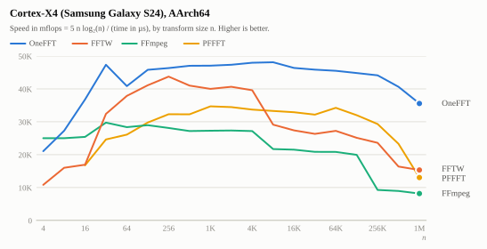
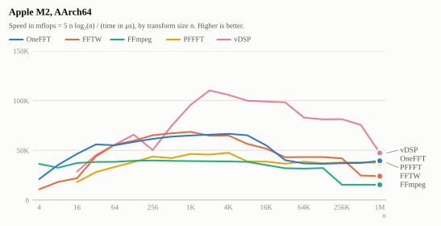
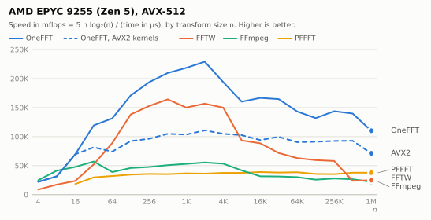
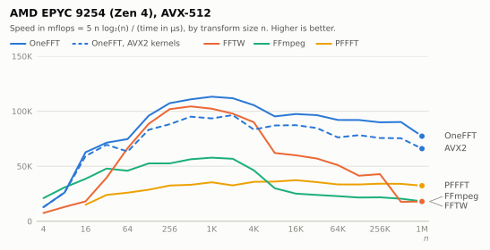
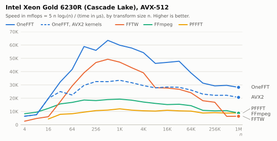
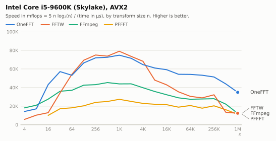

# OneFFT measurements

What was measured while building OneFFT, and what followed from it. [design.md](design.md)
describes the result; this document is the evidence behind its decisions, and the place to look
before trying to make something faster.

## Setup

| machine | core | instruction set |
|---|---|---|
| Google Pixel 3a | Kryo 360 Gold (Cortex-A75 derivative), 2.0 GHz | AArch64 |
| Samsung Galaxy A50 | Cortex-A73, 2.3 GHz | AArch64 |
| Samsung Galaxy S24 | Cortex-X4, 3.2 GHz | AArch64 |
| Apple M2 | Avalanche, 3.5 GHz | AArch64 |
| Laptop | AMD Ryzen 7 5700U (Zen 2), 4.3 GHz | AVX2 |
| Desktop | Intel Core i5-9600K (Skylake), 4.5 GHz | AVX2 |
| Server | AMD EPYC 7443P (Zen 3) | AVX2 |
| Server | AMD EPYC 9254 (Zen 4), 4.1 GHz | AVX-512 |
| Server | AMD EPYC 9255 (Zen 5), 4.3 GHz | AVX-512 |
| Server | Intel Xeon Gold 6230R (Cascade Lake), 2.1 GHz | AVX-512 |

All times are for one forward transform, single thread, pinned to the fastest cores on the
phones, minimum over 15 samples of at least 5 ms each (`bench/bench.c`). Every library is called
through its out-of-place interface on interleaved data, except vDSP, which only has split real
and imaginary arrays and is given those (the conversion is not timed, which favours it).

* FFTW 3.3.10, single precision, NEON or AVX2 and AVX-512 enabled, `FFTW_PATIENT` plans up to
  4096 points and `FFTW_MEASURE` above (patient planning of large sizes takes minutes).
* FFmpeg 7.1, `av_tx` with `AV_TX_FLOAT_FFT`, with its assembly for the target.
* PFFFT (the marton78 fork), `pffft_transform_ordered`; SSE or NEON, it has no AVX kernels.
* vDSP from Accelerate, `vDSP_DFT_Execute`.

`scripts/third_party.sh` builds the libraries and `scripts/build_bench.sh` the benchmark.
Compilers: Clang 18 (Android NDK r27c), Apple Clang 21, GCC 15.

Turbo is switched off on the Xeon: everything runs at 2.1 GHz there. With turbo, processors of
its generation run 512 bit code at a lower frequency than other code; what that does to the
AVX-512 kernels against the AVX2 kernels was not measured.

The input buffer is at the start of a page and the output buffer 2048 bytes behind one. Where
the two sit relative to each other matters for small transforms on some cores: with the same
offset in their pages, loads of the next transform wait for stores of the previous one. On
Zen 4 FFTW then takes 56 instead of 29 ns for 64 points and OneFFT 56 instead of 47 ns for 128;
on Cascade Lake OneFFT is up to 7% slower from 32 to 128 points. The benchmark also works for
half a second before it measures: a core that was just woken up has not reached its frequency
yet, and the first size came out up to 1.5 times too slow on the phones. Only Zen 3 was measured
before both, with buffers wherever the allocator put them (the server was not available again).

## Results

The charts show speed in "mflops": 5 n log2(n), the operation count of a textbook radix 2
transform of n points, divided by the time in microseconds. In this unit a library whose cost
per operation does not depend on the size draws a horizontal line, and the drop of every curve
towards the right is the transform outgrowing the caches. The tables under each chart have the
times in nanoseconds; their columns on the right are the time of the other library divided by
the time of OneFFT.

### Cortex-X4 (Galaxy S24)

<picture>
  <source media="(prefers-color-scheme: dark)" srcset="plots/s24-dark.svg">
  
</picture>

Times in nanoseconds

<!-- results:s24 -->
| n | OneFFT | FFTW | FFmpeg | PFFFT | vs FFTW | vs FFmpeg | vs PFFFT |
|--:|--:|--:|--:|--:|--:|--:|--:|
| 2 | 1.1 | 3.4 | 0.9 | - | 3.09 | 0.82 | - |
| 4 | 1.9 | 3.8 | 1.2 | - | 2.00 | 0.63 | - |
| 8 | 4.4 | 7.5 | 4.8 | - | 1.70 | 1.09 | - |
| 16 | 8.7 | 18.7 | 12.6 | 19.0 | 2.15 | 1.45 | 2.18 |
| 32 | 16.4 | 24.2 | 26.9 | 33.2 | 1.48 | 1.64 | 2.02 |
| 64 | 45.1 | 51.0 | 67.9 | 73.9 | 1.13 | 1.51 | 1.64 |
| 128 | 97.7 | 109.4 | 154.2 | 150.7 | 1.12 | 1.58 | 1.54 |
| 256 | 220.5 | 234.2 | 362.5 | 317.8 | 1.06 | 1.64 | 1.44 |
| 512 | 488.0 | 538.4 | 811.8 | 696.7 | 1.10 | 1.66 | 1.43 |
| 1024 | 1065 | 1250 | 1879 | 1489 | 1.17 | 1.76 | 1.40 |
| 2048 | 2332 | 2718 | 4123 | 3362 | 1.17 | 1.77 | 1.44 |
| 4096 | 5077 | 5701 | 9004 | 7112 | 1.12 | 1.77 | 1.40 |
| 8192 | 11435 | 17572 | 24186 | 15494 | 1.54 | 2.12 | 1.36 |
| 16384 | 24322 | 41256 | 53966 | 34386 | 1.70 | 2.22 | 1.41 |
| 32768 | 53457 | 92352 | 117398 | 74132 | 1.73 | 2.20 | 1.39 |
| 65536 | 114614 | 187395 | 250918 | 151965 | 1.64 | 2.19 | 1.33 |
| 131072 | 244849 | 452910 | 561308 | 346826 | 1.85 | 2.29 | 1.42 |
| 262144 | 523408 | 1000362 | 2480664 | 783203 | 1.91 | 4.74 | 1.50 |
| 524288 | 1211797 | 3074492 | 5571563 | 2163047 | 2.54 | 4.60 | 1.78 |
| 1048576 | 2930782 | 6612149 | 12775937 | 8027657 | 2.26 | 4.36 | 2.74 |
<!-- end -->

### Kryo 360 Gold (Pixel 3a)

<picture>
  <source media="(prefers-color-scheme: dark)" srcset="plots/pixel3a-dark.svg">
  
</picture>

Times in nanoseconds

<!-- results:pixel3a -->
| n | OneFFT | FFTW | FFmpeg | PFFFT | vs FFTW | vs FFmpeg | vs PFFFT |
|--:|--:|--:|--:|--:|--:|--:|--:|
| 2 | 4.0 | 11.5 | 4.0 | - | 2.88 | 1.00 | - |
| 4 | 8.9 | 15.9 | 5.7 | - | 1.79 | 0.64 | - |
| 8 | 22.2 | 28.9 | 21.6 | - | 1.30 | 0.97 | - |
| 16 | 43.1 | 67.7 | 54.2 | 89.4 | 1.57 | 1.26 | 2.07 |
| 32 | 93.5 | 119.9 | 144.5 | 156.6 | 1.28 | 1.55 | 1.67 |
| 64 | 238.2 | 250.8 | 335.8 | 344.8 | 1.05 | 1.41 | 1.45 |
| 128 | 559.0 | 538.8 | 795.8 | 741.1 | 0.96 | 1.42 | 1.33 |
| 256 | 1192 | 1151 | 1833 | 1539 | 0.97 | 1.54 | 1.29 |
| 512 | 2593 | 2579 | 4220 | 3381 | 0.99 | 1.63 | 1.30 |
| 1024 | 5834 | 5725 | 9482 | 7146 | 0.98 | 1.63 | 1.23 |
| 2048 | 12634 | 14316 | 21093 | 16119 | 1.13 | 1.67 | 1.28 |
| 4096 | 29180 | 35212 | 51932 | 41294 | 1.21 | 1.78 | 1.42 |
| 8192 | 62830 | 86675 | 121685 | 102853 | 1.38 | 1.94 | 1.64 |
| 16384 | 155495 | 211455 | 275615 | 220664 | 1.36 | 1.77 | 1.42 |
| 32768 | 347650 | 464128 | 655781 | 483145 | 1.34 | 1.89 | 1.39 |
| 65536 | 780820 | 1150286 | 1639922 | 1079974 | 1.47 | 2.10 | 1.38 |
| 131072 | 1786745 | 2790157 | 4698282 | 3437449 | 1.56 | 2.63 | 1.92 |
| 262144 | 4331251 | 5998699 | 14627710 | 9446250 | 1.38 | 3.38 | 2.18 |
| 524288 | 8992084 | 17438231 | 30991826 | 20560731 | 1.94 | 3.45 | 2.29 |
| 1048576 | 19480419 | 37079222 | 64838965 | 42778442 | 1.90 | 3.33 | 2.20 |
<!-- end -->

### Cortex-A73 (Galaxy A50)

<picture>
  <source media="(prefers-color-scheme: dark)" srcset="plots/a50-dark.svg">
  
</picture>

Times in nanoseconds

<!-- results:a50 -->
| n | OneFFT | FFTW | FFmpeg | PFFFT | vs FFTW | vs FFmpeg | vs PFFFT |
|--:|--:|--:|--:|--:|--:|--:|--:|
| 2 | 4.8 | 15.2 | 4.8 | - | 3.17 | 1.00 | - |
| 4 | 10.6 | 20.8 | 7.6 | - | 1.96 | 0.72 | - |
| 8 | 27.5 | 37.6 | 24.2 | - | 1.37 | 0.88 | - |
| 16 | 46.7 | 87.8 | 59.5 | 106.4 | 1.88 | 1.27 | 2.28 |
| 32 | 93.4 | 135.4 | 140.6 | 176.7 | 1.45 | 1.51 | 1.89 |
| 64 | 247.6 | 261.8 | 332.2 | 406.4 | 1.06 | 1.34 | 1.64 |
| 128 | 605.0 | 543.0 | 788.1 | 885.5 | 0.90 | 1.30 | 1.46 |
| 256 | 1277 | 1171 | 1822 | 1887 | 0.92 | 1.43 | 1.48 |
| 512 | 2677 | 2774 | 4208 | 4227 | 1.04 | 1.57 | 1.58 |
| 1024 | 6407 | 6809 | 9518 | 8940 | 1.06 | 1.49 | 1.40 |
| 2048 | 14778 | 15745 | 23105 | 22889 | 1.07 | 1.56 | 1.55 |
| 4096 | 32760 | 37823 | 59516 | 53824 | 1.15 | 1.82 | 1.64 |
| 8192 | 81630 | 100630 | 141056 | 127062 | 1.23 | 1.73 | 1.56 |
| 16384 | 170288 | 226726 | 309072 | 250625 | 1.33 | 1.81 | 1.47 |
| 32768 | 374240 | 541457 | 682038 | 634452 | 1.45 | 1.82 | 1.70 |
| 65536 | 905154 | 1456980 | 2060020 | 1684346 | 1.61 | 2.28 | 1.86 |
| 131072 | 2036846 | 3425769 | 6123154 | 5838577 | 1.68 | 3.01 | 2.87 |
| 262144 | 4767000 | 7681847 | 17338769 | 10369846 | 1.61 | 3.64 | 2.18 |
| 524288 | 10013424 | 19744615 | 36122308 | 26964346 | 1.97 | 3.61 | 2.69 |
| 1048576 | 21215846 | 42221731 | 76520807 | 47696770 | 1.99 | 3.61 | 2.25 |
<!-- end -->

### Apple M2

<picture>
  <source media="(prefers-color-scheme: dark)" srcset="plots/m2-dark.svg">
  
</picture>

Times in nanoseconds

<!-- results:m2 -->
| n | OneFFT | FFTW | FFmpeg | PFFFT | vDSP | vs FFTW | vs FFmpeg | vs PFFFT | vs vDSP |
|--:|--:|--:|--:|--:|--:|--:|--:|--:|--:|
| 2 | 1.4 | 2.6 | 1.1 | - | - | 1.86 | 0.79 | - | - |
| 4 | 1.9 | 3.8 | 1.2 | - | - | 2.00 | 0.63 | - | - |
| 8 | 3.5 | 6.8 | 3.8 | - | - | 1.94 | 1.09 | - | - |
| 16 | 6.9 | 15.0 | 8.6 | 17.8 | 11.2 | 2.17 | 1.25 | 2.58 | 1.62 |
| 32 | 14.3 | 18.2 | 20.9 | 29.4 | 17.7 | 1.27 | 1.46 | 2.06 | 1.24 |
| 64 | 35.9 | 35.5 | 50.0 | 58.7 | 34.6 | 0.99 | 1.39 | 1.64 | 0.96 |
| 128 | 78.9 | 75.3 | 114.3 | 120.6 | 68.2 | 0.95 | 1.45 | 1.53 | 0.86 |
| 256 | 171.3 | 161.0 | 257.7 | 241.5 | 154.3 | 0.94 | 1.50 | 1.41 | 0.90 |
| 512 | 371.5 | 353.4 | 585.0 | 560.9 | 328.1 | 0.95 | 1.57 | 1.51 | 0.88 |
| 1024 | 811.5 | 768.8 | 1307 | 1134 | 536.5 | 0.95 | 1.61 | 1.40 | 0.66 |
| 2048 | 1714 | 1790 | 2890 | 2554 | 1023 | 1.04 | 1.69 | 1.49 | 0.60 |
| 4096 | 3693 | 3949 | 6332 | 5230 | 2319 | 1.07 | 1.71 | 1.42 | 0.63 |
| 8192 | 8273 | 9789 | 14312 | 14023 | 5330 | 1.18 | 1.73 | 1.69 | 0.64 |
| 16384 | 18695 | 23062 | 33555 | 29680 | 11594 | 1.23 | 1.79 | 1.59 | 0.62 |
| 32768 | 40984 | 58078 | 79062 | 66453 | 25016 | 1.42 | 1.93 | 1.62 | 0.61 |
| 65536 | 87406 | 126375 | 170500 | 131750 | 63266 | 1.45 | 1.95 | 1.51 | 0.72 |
| 131072 | 182688 | 266062 | 355375 | 295000 | 137344 | 1.46 | 1.95 | 1.61 | 0.75 |
| 262144 | 386875 | 599375 | 1580500 | 590750 | 284812 | 1.55 | 4.09 | 1.53 | 0.74 |
| 524288 | 821000 | 2122500 | 3282000 | 1288000 | 673000 | 2.59 | 4.00 | 1.57 | 0.82 |
| 1048576 | 1894000 | 4549000 | 7052000 | 2696000 | 2368000 | 2.40 | 3.72 | 1.42 | 1.25 |
<!-- end -->

### AMD EPYC 9255 (Zen 5), AVX-512

<picture>
  <source media="(prefers-color-scheme: dark)" srcset="plots/zen5-dark.svg">
  
</picture>

"OneFFT (AVX2)" is OneFFT built with `-DONEFFT_NO_AVX512`. FFTW and FFmpeg use AVX-512 where
they have code for it.

Times in nanoseconds

<!-- results:zen5 -->
| n | OneFFT | OneFFT (AVX2) | FFTW | FFmpeg | PFFFT | vs OneFFT (AVX2) | vs FFTW | vs FFmpeg | vs PFFFT |
|--:|--:|--:|--:|--:|--:|--:|--:|--:|--:|
| 2 | 1.1 | 1.1 | 3.2 | 1.6 | - | 1.00 | 2.91 | 1.45 | - |
| 4 | 1.8 | 1.8 | 4.5 | 1.6 | - | 1.00 | 2.50 | 0.89 | - |
| 8 | 3.8 | 3.8 | 6.9 | 2.9 | - | 1.00 | 1.82 | 0.76 | - |
| 16 | 4.6 | 4.6 | 13.5 | 6.7 | 17.4 | 1.00 | 2.93 | 1.46 | 3.78 |
| 32 | 6.7 | 9.8 | 15.3 | 14.0 | 26.8 | 1.46 | 2.28 | 2.09 | 4.00 |
| 64 | 14.6 | 25.9 | 21.6 | 49.3 | 59.7 | 1.77 | 1.48 | 3.38 | 4.09 |
| 128 | 26.2 | 48.5 | 32.4 | 97.4 | 129.5 | 1.85 | 1.24 | 3.72 | 4.94 |
| 256 | 52.8 | 106.3 | 67.0 | 214.5 | 286.3 | 2.01 | 1.27 | 4.06 | 5.42 |
| 512 | 109.9 | 219.8 | 140.3 | 453.3 | 651.1 | 2.00 | 1.28 | 4.12 | 5.92 |
| 1024 | 234.4 | 494.4 | 341.1 | 964.9 | 1395 | 2.11 | 1.46 | 4.12 | 5.95 |
| 2048 | 491.8 | 1017 | 718.5 | 2031 | 3108 | 2.07 | 1.46 | 4.13 | 6.32 |
| 4096 | 1267 | 2345 | 1639 | 4599 | 6545 | 1.85 | 1.29 | 3.63 | 5.16 |
| 8192 | 3324 | 5192 | 5701 | 12746 | 14185 | 1.56 | 1.72 | 3.84 | 4.27 |
| 16384 | 6880 | 12183 | 12957 | 36176 | 29410 | 1.77 | 1.88 | 5.26 | 4.27 |
| 32768 | 14928 | 24674 | 34258 | 78244 | 64482 | 1.65 | 2.29 | 5.24 | 4.32 |
| 65536 | 36592 | 57979 | 83225 | 173332 | 135790 | 1.58 | 2.27 | 4.74 | 3.71 |
| 131072 | 84447 | 122116 | 187263 | 430886 | 312061 | 1.45 | 2.22 | 5.10 | 3.70 |
| 262144 | 164064 | 254913 | 406242 | 846404 | 667342 | 1.55 | 2.48 | 5.16 | 4.07 |
| 524288 | 356344 | 536425 | 2092234 | 1872943 | 1314524 | 1.51 | 5.87 | 5.26 | 3.69 |
| 1048576 | 951749 | 1470756 | 4200779 | 4741443 | 2767490 | 1.55 | 4.41 | 4.98 | 2.91 |
<!-- end -->

### AMD EPYC 9254 (Zen 4), AVX-512

<picture>
  <source media="(prefers-color-scheme: dark)" srcset="plots/zen4-dark.svg">
  
</picture>

Times in nanoseconds

<!-- results:zen4 -->
| n | OneFFT | OneFFT (AVX2) | FFTW | FFmpeg | PFFFT | vs OneFFT (AVX2) | vs FFTW | vs FFmpeg | vs PFFFT |
|--:|--:|--:|--:|--:|--:|--:|--:|--:|--:|
| 2 | 1.7 | 1.7 | 4.8 | 2.2 | - | 1.00 | 2.82 | 1.29 | - |
| 4 | 3.1 | 3.1 | 5.3 | 1.9 | - | 1.00 | 1.71 | 0.61 | - |
| 8 | 4.6 | 4.6 | 9.2 | 3.9 | - | 1.00 | 2.00 | 0.85 | - |
| 16 | 5.1 | 5.4 | 17.7 | 8.3 | 21.3 | 1.06 | 3.47 | 1.63 | 4.18 |
| 32 | 11.2 | 11.5 | 20.2 | 16.7 | 33.4 | 1.03 | 1.80 | 1.49 | 2.98 |
| 64 | 25.7 | 30.3 | 28.9 | 41.8 | 73.9 | 1.18 | 1.12 | 1.63 | 2.88 |
| 128 | 46.7 | 53.9 | 50.6 | 85.2 | 156.4 | 1.15 | 1.08 | 1.82 | 3.35 |
| 256 | 95.4 | 116.1 | 100.5 | 194.7 | 315.2 | 1.22 | 1.05 | 2.04 | 3.30 |
| 512 | 207.9 | 242.3 | 220.7 | 408.9 | 695.3 | 1.17 | 1.06 | 1.97 | 3.34 |
| 1024 | 452.2 | 547.6 | 500.4 | 885.9 | 1446 | 1.21 | 1.11 | 1.96 | 3.20 |
| 2048 | 1007 | 1167 | 1151 | 1984 | 3456 | 1.16 | 1.14 | 1.97 | 3.43 |
| 4096 | 2328 | 2947 | 2730 | 5303 | 6857 | 1.27 | 1.17 | 2.28 | 2.95 |
| 8192 | 5588 | 6115 | 8582 | 17762 | 14772 | 1.09 | 1.54 | 3.18 | 2.64 |
| 16384 | 11767 | 13132 | 19124 | 45654 | 30717 | 1.12 | 1.63 | 3.88 | 2.61 |
| 32768 | 25478 | 29001 | 43110 | 102702 | 69102 | 1.14 | 1.69 | 4.03 | 2.71 |
| 65536 | 56942 | 68772 | 102740 | 229704 | 156611 | 1.21 | 1.80 | 4.03 | 2.75 |
| 131072 | 121054 | 142349 | 269067 | 516227 | 333202 | 1.18 | 2.22 | 4.26 | 2.75 |
| 262144 | 262310 | 311763 | 550616 | 1085104 | 690566 | 1.19 | 2.10 | 4.14 | 2.63 |
| 524288 | 552103 | 660058 | 2826413 | 2429432 | 1464796 | 1.20 | 5.12 | 4.40 | 2.65 |
| 1048576 | 1356126 | 1588827 | 5843846 | 5781116 | 3243614 | 1.17 | 4.31 | 4.26 | 2.39 |
<!-- end -->

### Intel Xeon Gold 6230R (Cascade Lake), AVX-512

<picture>
  <source media="(prefers-color-scheme: dark)" srcset="plots/clx-dark.svg">
  
</picture>

At 2.1 GHz, without turbo (see Setup). The times are the minimum of two runs of the benchmark:
on this machine a whole run is sometimes 5 to 15% slower than another at the small sizes.

Times in nanoseconds

<!-- results:clx -->
| n | OneFFT | OneFFT (AVX2) | FFTW | FFmpeg | PFFFT | vs OneFFT (AVX2) | vs FFTW | vs FFmpeg | vs PFFFT |
|--:|--:|--:|--:|--:|--:|--:|--:|--:|--:|
| 2 | 4.3 | 4.3 | 13.0 | 3.3 | - | 1.00 | 3.02 | 0.77 | - |
| 4 | 6.2 | 6.2 | 14.8 | 4.8 | - | 1.00 | 2.39 | 0.77 | - |
| 8 | 15.8 | 15.9 | 25.3 | 12.7 | - | 1.01 | 1.60 | 0.80 | - |
| 16 | 16.1 | 16.1 | 52.4 | 25.9 | 73.3 | 1.00 | 3.25 | 1.61 | 4.55 |
| 32 | 24.8 | 32.0 | 46.0 | 50.9 | 101.5 | 1.29 | 1.85 | 2.05 | 4.09 |
| 64 | 46.1 | 85.8 | 65.7 | 114.0 | 231.1 | 1.86 | 1.43 | 2.47 | 5.01 |
| 128 | 76.1 | 150.9 | 114.5 | 240.4 | 470.8 | 1.98 | 1.50 | 3.16 | 6.19 |
| 256 | 182.9 | 314.9 | 218.7 | 562.3 | 960.7 | 1.72 | 1.20 | 3.07 | 5.25 |
| 512 | 362.8 | 710.3 | 467.2 | 1215 | 2084 | 1.96 | 1.29 | 3.35 | 5.75 |
| 1024 | 855.3 | 1530 | 1086 | 2654 | 4267 | 1.79 | 1.27 | 3.10 | 4.99 |
| 2048 | 1951 | 3556 | 2621 | 6081 | 10227 | 1.82 | 1.34 | 3.12 | 5.24 |
| 4096 | 4530 | 8335 | 6290 | 14358 | 23336 | 1.84 | 1.39 | 3.17 | 5.15 |
| 8192 | 11531 | 19161 | 19086 | 33116 | 51648 | 1.66 | 1.66 | 2.87 | 4.48 |
| 16384 | 24431 | 40339 | 41490 | 75416 | 104778 | 1.65 | 1.70 | 3.09 | 4.29 |
| 32768 | 51405 | 87156 | 91970 | 158966 | 234557 | 1.70 | 1.79 | 3.09 | 4.56 |
| 65536 | 134502 | 200795 | 217772 | 364579 | 510007 | 1.49 | 1.62 | 2.71 | 3.79 |
| 131072 | 355474 | 482570 | 615795 | 1025818 | 1259966 | 1.36 | 1.73 | 2.89 | 3.54 |
| 262144 | 806249 | 1064157 | 1391384 | 2254765 | 2587401 | 1.32 | 1.73 | 2.80 | 3.21 |
| 524288 | 1678925 | 2244860 | 7821413 | 4680275 | 5664419 | 1.34 | 4.66 | 2.79 | 3.37 |
| 1048576 | 3722387 | 5085460 | 16320123 | 11973013 | 11764916 | 1.37 | 4.38 | 3.22 | 3.16 |
<!-- end -->

### Intel Core i5-9600K (Skylake), AVX2

<picture>
  <source media="(prefers-color-scheme: dark)" srcset="plots/intel-dark.svg">
  
</picture>

Times in nanoseconds

<!-- results:intel -->
| n | OneFFT | FFTW | FFmpeg | PFFFT | vs FFTW | vs FFmpeg | vs PFFFT |
|--:|--:|--:|--:|--:|--:|--:|--:|
| 2 | 2.0 | 5.9 | 1.5 | - | 2.95 | 0.75 | - |
| 4 | 2.8 | 6.9 | 2.2 | - | 2.46 | 0.79 | - |
| 8 | 7.0 | 11.6 | 5.7 | - | 1.66 | 0.81 | - |
| 16 | 7.4 | 24.6 | 11.6 | 31.6 | 3.32 | 1.57 | 4.27 |
| 32 | 14.0 | 23.4 | 22.2 | 46.4 | 1.67 | 1.59 | 3.31 |
| 64 | 36.1 | 35.4 | 51.8 | 105.3 | 0.98 | 1.43 | 2.92 |
| 128 | 67.4 | 64.6 | 105.2 | 219.6 | 0.96 | 1.56 | 3.26 |
| 256 | 142.4 | 136.6 | 237.5 | 425.1 | 0.96 | 1.67 | 2.99 |
| 512 | 317.5 | 312.4 | 508.0 | 920.2 | 0.98 | 1.60 | 2.90 |
| 1024 | 684.5 | 648.1 | 1165 | 1871 | 0.95 | 1.70 | 2.73 |
| 2048 | 1576 | 1532 | 2560 | 4482 | 0.97 | 1.62 | 2.84 |
| 4096 | 3803 | 3601 | 6171 | 10690 | 0.95 | 1.62 | 2.81 |
| 8192 | 8728 | 11102 | 14892 | 24163 | 1.27 | 1.71 | 2.77 |
| 16384 | 19374 | 26721 | 35534 | 53057 | 1.38 | 1.83 | 2.74 |
| 32768 | 45276 | 69364 | 84821 | 129869 | 1.53 | 1.87 | 2.87 |
| 65536 | 96833 | 171633 | 191130 | 252980 | 1.77 | 1.97 | 2.61 |
| 131072 | 209243 | 385388 | 401638 | 625372 | 1.84 | 1.92 | 2.99 |
| 262144 | 459237 | 732377 | 841954 | 1157209 | 1.59 | 1.83 | 2.52 |
| 524288 | 1134748 | 3718173 | 2246893 | 3082268 | 3.28 | 1.98 | 2.72 |
| 1048576 | 3007179 | 8445645 | 8539022 | 9283227 | 2.81 | 2.84 | 3.09 |
<!-- end -->

### AMD EPYC 7443P (Zen 3), AVX2

<picture>
  <source media="(prefers-color-scheme: dark)" srcset="plots/epyc-dark.svg">
  
</picture>

Measured before the first pass learned to write in order (see "Decisions and their effect").
On Zen 2 and Zen 4 that made 8192 to 524288 points 5 to 15% faster with the AVX2 kernels; the
same is to be expected here.

Times in nanoseconds

<!-- results:epyc -->
| n | OneFFT | FFTW | FFmpeg | PFFFT | vs FFTW | vs FFmpeg | vs PFFFT |
|--:|--:|--:|--:|--:|--:|--:|--:|
| 2 | 3.4 | 7.4 | 2.1 | - | 2.18 | 0.62 | - |
| 4 | 4.6 | 8.5 | 3.9 | - | 1.85 | 0.85 | - |
| 8 | 7.5 | 14.5 | 7.1 | - | 1.93 | 0.95 | - |
| 16 | 8.8 | 31.4 | 14.9 | 33.4 | 3.57 | 1.69 | 3.80 |
| 32 | 19.3 | 30.3 | 30.0 | 54.3 | 1.57 | 1.55 | 2.81 |
| 64 | 46.5 | 47.2 | 74.0 | 113.4 | 1.02 | 1.59 | 2.44 |
| 128 | 88.9 | 89.0 | 142.9 | 240.2 | 1.00 | 1.61 | 2.70 |
| 256 | 185.1 | 169.1 | 318.8 | 478.5 | 0.91 | 1.72 | 2.59 |
| 512 | 394.9 | 441.0 | 692.2 | 1101 | 1.12 | 1.75 | 2.79 |
| 1024 | 840.3 | 849.0 | 1498 | 2174 | 1.01 | 1.78 | 2.59 |
| 2048 | 1947 | 2045 | 3334 | 4992 | 1.05 | 1.71 | 2.56 |
| 4096 | 4505 | 4892 | 8685 | 10788 | 1.09 | 1.93 | 2.39 |
| 8192 | 10946 | 15419 | 28277 | 23188 | 1.41 | 2.58 | 2.12 |
| 16384 | 22531 | 39125 | 72073 | 49746 | 1.74 | 3.20 | 2.21 |
| 32768 | 52796 | 101118 | 167429 | 124081 | 1.92 | 3.17 | 2.35 |
| 65536 | 121752 | 209993 | 396611 | 265136 | 1.72 | 3.26 | 2.18 |
| 131072 | 257086 | 468810 | 833370 | 545456 | 1.82 | 3.24 | 2.12 |
| 262144 | 535243 | 1090049 | 1781685 | 1129582 | 2.04 | 3.33 | 2.11 |
| 524288 | 1120759 | 4546586 | 3991483 | 2439349 | 4.06 | 3.56 | 2.18 |
| 1048576 | 2383984 | 9825527 | 8988031 | 5199750 | 4.12 | 3.77 | 2.18 |
<!-- end -->

### AMD Ryzen 7 5700U (Zen 2), AVX2

<picture>
  <source media="(prefers-color-scheme: dark)" srcset="plots/zen2-dark.svg">
  
</picture>

Times in nanoseconds

<!-- results:zen2 -->
| n | OneFFT | FFTW | FFmpeg | PFFFT | vs FFTW | vs FFmpeg | vs PFFFT |
|--:|--:|--:|--:|--:|--:|--:|--:|
| 2 | 1.8 | 6.5 | 1.9 | - | 3.61 | 1.06 | - |
| 4 | 3.6 | 7.7 | 2.8 | - | 2.14 | 0.78 | - |
| 8 | 6.7 | 12.5 | 6.3 | - | 1.87 | 0.94 | - |
| 16 | 8.1 | 25.0 | 11.5 | 27.2 | 3.09 | 1.42 | 3.36 |
| 32 | 15.4 | 25.4 | 23.0 | 42.9 | 1.65 | 1.49 | 2.79 |
| 64 | 40.3 | 37.6 | 61.8 | 93.2 | 0.93 | 1.53 | 2.31 |
| 128 | 75.3 | 74.7 | 119.1 | 199.8 | 0.99 | 1.58 | 2.65 |
| 256 | 168.8 | 144.8 | 269.9 | 404.7 | 0.86 | 1.60 | 2.40 |
| 512 | 340.1 | 324.4 | 593.3 | 903.2 | 0.95 | 1.74 | 2.66 |
| 1024 | 754.1 | 709.4 | 1272 | 1885 | 0.94 | 1.69 | 2.50 |
| 2048 | 1569 | 1637 | 2808 | 4302 | 1.04 | 1.79 | 2.74 |
| 4096 | 3787 | 4006 | 6616 | 9199 | 1.06 | 1.75 | 2.43 |
| 8192 | 8115 | 11569 | 19444 | 19730 | 1.43 | 2.40 | 2.43 |
| 16384 | 18999 | 27932 | 54369 | 40927 | 1.47 | 2.86 | 2.15 |
| 32768 | 39941 | 69636 | 155828 | 93463 | 1.74 | 3.90 | 2.34 |
| 65536 | 86095 | 160752 | 316536 | 199715 | 1.87 | 3.68 | 2.32 |
| 131072 | 221772 | 345542 | 666672 | 483800 | 1.56 | 3.01 | 2.18 |
| 262144 | 620910 | 991851 | 1981086 | 1621658 | 1.60 | 3.19 | 2.61 |
| 524288 | 2279444 | 5008482 | 6511931 | 6622131 | 2.20 | 2.86 | 2.91 |
| 1048576 | 5409455 | 10718990 | 14779559 | 13809826 | 1.98 | 2.73 | 2.55 |
<!-- end -->

### SSE2

The SSE2 kernels on the i5-9600K (built with `-DONEFFT_NO_AVX2`) against PFFFT, which is also
SSE. They were not tuned.

<!-- results:intel_sse2 -->
| n | OneFFT | PFFFT | vs PFFFT |
|--:|--:|--:|--:|
| 8 | 7.2 | - | - |
| 16 | 13.3 | 34.2 | 2.57 |
| 32 | 41.3 | 46.1 | 1.12 |
| 64 | 80.0 | 105.1 | 1.31 |
| 128 | 194.6 | 217.5 | 1.12 |
| 256 | 390.8 | 425.4 | 1.09 |
| 512 | 920.3 | 944.7 | 1.03 |
| 1024 | 1889 | 1927 | 1.02 |
| 2048 | 4426 | 4589 | 1.04 |
| 4096 | 9836 | 10823 | 1.10 |
| 8192 | 22466 | 24931 | 1.11 |
| 16384 | 46670 | 54980 | 1.18 |
| 32768 | 106882 | 127050 | 1.19 |
| 65536 | 216638 | 258271 | 1.19 |
<!-- end -->

### Summary

* Against FFmpeg, OneFFT is 1.25 to 5.3 times faster from 16 points up, on every machine.
  Against PFFFT 1.2 to 6.3 times. At 4 and 8 points FFmpeg's dedicated kernels are up to 1.6
  times faster than OneFFT's.
* Against patient FFTW there are three ranges. Up to 32 points OneFFT's single kernels are 1.3 to
  3.6 times faster. From 8192 points up OneFFT is 1.2 to 5.9 times faster: its passes stay cache
  friendly, and FFTW's measured (not patient) plans are weaker. Between 64 and 4096 points both
  are close with NEON and AVX2, OneFFT being between 14% slower and 21% faster (ahead at every
  size on the Cortex-X4, behind at most on Zen 2); FFTW's patient planner picks large generated
  codelets there that need very few passes.
* With AVX-512, OneFFT is ahead of FFTW (which has AVX-512 codelets) at every size, also between
  64 and 4096 points: by 1.24 to 1.5 times there on Zen 5, by 1.2 to 1.5 times on Cascade
  Lake and by 1.05 to 1.17 times on Zen 4. Against its own AVX2 kernels on the same machine it
  is 1.45 to 2.1 times faster on Zen 5 from 32 points up, 1.3 to 2.0 times on Cascade Lake
  (1.7 to 2.0 times from 64 to 4096 points, 1.3 to 1.7 times above), and 1.1 to 1.27 times on
  Zen 4 from 64 points up; a 512 bit operation is two 256 bit operations on Zen 4.
* The order in which the first pass goes through its butterflies decides large transforms on
  some cores (see "Decisions and their effect"). The M2 used to be the exception at the top,
  with FFTW up to 16% faster between 2^15 and 2^18 points; with the first pass writing in
  order OneFFT is 1.4 to 1.55 times faster than FFTW there.
* Apple's vDSP is the fastest library on the M2: 1.1 to 1.7 times faster than OneFFT from 128
  to 524288 points, and faster than FFTW (at 2^20 points OneFFT is ahead). It is the only other
  library here that is written for one specific family of cores, and the only one that does
  not have to split and interleave.
* The 2021 proof of concept in `reference/` takes 6.9 us for 1024 points on the Pixel 3a, 6.6 us
  on the A50, 2.1 us on the S24 and 1.5 us on the M2: 1.04 to 1.9 times the time of OneFFT.

### The dip at 64 points

Several curves dip at 64 points: OneFFT with AVX2 (on Skylake and Zen 2, and its AVX2 kernels
on Zen 4, Zen 5 and Cascade Lake) and with NEON on the Cortex-X4, and FFmpeg on the Zen cores.
This is not the effect of where the buffers are (see Setup), which showed on Zen 4 (in FFTW
at 64 points and in OneFFT at 128) and by a few percent on Cascade Lake:

* The time for 64 points does not depend on the position of the output buffer in its page.
  With the buffer at 0, 64, 512, 1024, 2048, 3072 and 4032 bytes OneFFT takes 25.5 to 26.3 ns
  with AVX2 on Zen 5, 41.3 to 42.0 ns on Zen 2, 44.7 to 45.5 ns on the Cortex-X4 and 34.9 to
  36.4 ns on the M2, and FFmpeg 49.5 to 49.9 ns on Zen 5. Skylake and Cascade Lake vary more
  from run to run than with the position (36 to 40 and 46 to 48 ns).
* The phones and Skylake were first measured with buffers wherever the allocator put them.
  The tables above are from new runs with fixed buffers and differ from the first ones by a
  few percent, at 64 points by at most 4% (Skylake 9%).

It is the step from a kernel to passes. Up to 32 points a transform is one kernel that keeps
everything in registers. 64 points is the smallest size done in passes, and the size that gets
the least out of each: with AVX2 three kernels (`f4`, `la2`, `lb`) for 6 index bits, while 128
and 256 points transform 7 and 8 bits with three. The kernels themselves are as fast as at
other sizes (`bench/passes.c` on the Cortex-X4: `f8` and `l8` take 22 and 46 cycles per
butterfly at 64 points, 22 and 43 at 256), but splitting the input, interleaving the output
and the kernel calls cost the same for fewer bits. In the unit of the charts OneFFT with AVX2
is 18 to 25% below the level of 128 points on the x86 cores; with NEON, where 64 points are
two kernels, 7% on the Cortex-X4, 6% on the M2 and not at all on the older cores, whose curves
only stand out at 32 points.

With AVX-512, 64 and 128 points are single kernels and those curves have no dip at 64. The same
step is at 256 points there, the first size in passes (Cascade Lake: 5% below 128 points). A
64 point kernel for AVX2 was not built: 8 complex vectors fill the 16 registers, so that the
three lane exchanges would need memory for their intermediate results, which is most of what
the passes cost. FFTW's 64 point codelet is as fast as the three passes on Skylake (35 against
36 ns) and 7% faster on Zen 2 (38 against 40 ns).

FFmpeg's dip on Zen 5 (50 ns for 64 points, 14 ns for 32; Zen 4 takes 42 ns) is in its own
code: the processor executes 2.0 instructions per cycle there, against 3.8 at 32 points.

## What the cores can do

`bench/uops_aarch64.c` and `bench/uops_x86.c` run loops of independent instructions of one kind.
The numbers explain most of what the pass timings (`bench/passes.c`) show.

### AArch64: cycles per instruction

| | Kryo 360 | Cortex-A73 | Cortex-X4 | Apple M2 |
|---|--:|--:|--:|--:|
| `fadd`, `fmul`, `fmla`, 4 lanes | 0.9 | 0.9 | 0.25 | 0.25 |
| the same with 2 lanes or scalar | 0.37 | 0.47 | 0.25 | 0.25 |
| `trn`, `zip`, `uzp` | 0.55 | 0.6 | 0.25 | 0.25 |
| `mov` between vector registers | 0.55 | 0.6 | 0.25 | 0.1 (free) |
| `ldr q` | 0.9 | 1.0 | 0.27 | 0.29 |
| `ldp q, q` | 2.2 | 2.0 | 0.60 | 0.65 |
| `ld2` (4 lanes) | 2.2 | 2.6 | 0.93 | 0.94 |
| `str q` | 0.9 | 1.9 | 0.44 | 0.44 |
| `stp q, q` | 1.9 | 4.0 | 0.93 | 0.94 |
| `st2` (4 lanes) | 1.9 | 4.2 | 0.93 | 0.94 |
| `ld2` of one lane | 0.9 | 0.9 | 0.93 | 0.45 |

What follows:

* **The older cores execute one 128 bit floating point operation per cycle**, half the rate of
  their 64 bit operations: their SIMD units are 64 bits wide. A load or store of a register
  costs about as much as an arithmetic operation. On these cores the time of a kernel is close
  to the number of 128 bit operations it executes, counting loads and stores. A 1024 point
  transform is about 8200 arithmetic operations and 1000 shuffles in OneFFT; the two codelets of
  FFTW's plan (two radix 32 passes) come to about 7800 and 2000, counted in their disassembly.
  That is why the two are equal there, and why reordering the same arithmetic does not help.
* **The current cores execute four operations per cycle**, and OneFFT's passes reach 3 to 3.4.
  Loads are nearly free, stores are limited to two registers per cycle.
* **Loading one lane costs as much as loading a whole register** everywhere but on Apple. The
  proof of concept gathers its 32 values lane by lane; that is 4 times the load and store
  instructions per pass and the reason for the different structure of OneFFT.
* `ld2` and `st2` are no bargain: they run at one per cycle on the fast cores. `ldp` with two
  `uzp` is equally fast or faster.
* A `mov` is free only on Apple. This decides whether butterflies made from fused multiply-adds
  (6 operations and 3 copies instead of 8 operations) pay off. Measured on the M2: 876 to
  798 ns at 1024 points.
* On the Cortex-X4, registers that hold subnormal numbers or NaNs make arithmetic 2.3 times
  slower. Benchmarks must not run on uninitialised registers or on data that has decayed to
  subnormals.

### x86-64: 256 bit instructions per cycle

| | Skylake, Cascade Lake | Zen 2 | Zen 3 |
|---|--:|--:|--:|
| loads | 2 | 2 | 2 |
| stores | 1 | 1 | 1 |
| additions | 2 | 2 | 2 |
| multiplications, fused multiply-adds | 2 | 2 | 2 |
| additions and multiplications together | 2 | 4 | 4 |
| `unpck`, `shufps` | 1 | 2 | 2 |
| `vperm2f128`, `vinsertf128` between registers | 1 | 1 | 1 |

What follows:

* **One store per cycle** on all three. A radix 4 pass over 32 values is 8 stores, as long as
  its arithmetic takes on a good day. Fewer passes matter more than on AArch64, hence the two
  radix 8 kernels that work in place (design.md).
* **Skylake** shares two units between additions and multiplications and has one for shuffles.
  Its pipeline is 4 instructions wide, and the kernels run close to that limit as well: the
  instruction count matters, and memory operands (a load fused with the operation) are worth
  using everywhere.
* **Zen** has separate units for additions and multiplications. Standard butterflies use both
  evenly. The in-place kernels lean on fused multiply-adds and are limited by those units; the
  radix 8 pass before the last gained 6 to 10% at even sizes on Skylake and nothing on Zen 3.
  On Zen 2, stores additionally occupy one of the two addition units.
* Moving the 128 bit halves of registers around is slow everywhere. `lb` does it while loading.

### x86-64: 512 bit instructions per cycle

| | Zen 4 | Zen 5 | Cascade Lake |
|---|--:|--:|--:|
| loads | 1 | 2 | 2 |
| stores | 0.5 | 1 | 1 |
| additions | 1 | 2 | 2 |
| multiplications, fused multiply-adds | 1 | 2 | 2 |
| additions and multiplications together | 2 | 4 | 2 |
| `unpck`, `shufps` | 1.5 | 4 | 1 |
| `vshuff32x4` | 1 | 2 | 1 |
| shuffles and additions together | - | 4 | 2 |
| cycles for a load, two multiplications by a twiddle vector and a store: twiddle as memory operands / loaded into a register | 3.2 / 2.2 | 1.5 / 1.0 | 1.9 / 1.4 |

(`bench/uops_x86.c` built with `-DWIDE -mavx512f`. The buffer it reads and the one it writes
must not have the same offset in their pages: a load then waits for the stores before it, and
the tests with loads and stores came out up to 1.8 times too slow on Cascade Lake.) What
follows:

* **Zen 4 executes a 512 bit operation as two of 256 bits.** It moves no more data per cycle
  than with AVX2, and stores one register every other cycle. What AVX-512 gives it is 32
  registers: higher radix, so fewer passes and fewer stores, and twiddles in registers.
* **Zen 5 has the full width**, twice the arithmetic of its 256 bit operations per cycle. It
  does not store more data per cycle than with AVX2 either (one 512 bit register or two of 256
  bits), so stores weigh twice as much relative to arithmetic.
* **A memory operand is a load**, an embedded broadcast of a scalar as well, and loads are
  scarce: the last row of the table. The kernels as first written (scalar twiddles as embedded
  broadcasts, twiddle vectors as memory operands, as in the AVX2 kernels that have no registers
  to spare) were limited by loads. A radix 4 middle pass has 8 loads of data and used 12 for its
  twiddles; with the twiddles broadcast into registers it has 6.
* **Additions and multiplications run on separate units**, two each. A butterfly with a twiddle
  is four of each. A butterfly without is four additions, or two additions and two fused
  multiply-adds as `(a + b, (a + b) - 2 b)`: the first passes are built from those. The radix 8
  first pass went from 66 to 44 cycles per butterfly on Zen 4. On Zen 5 it only paid off
  together with the constant in a register (34 to 27 cycles; with the constant as an embedded
  broadcast the 24 additional loads ate the gain).
* **The kernels reach 2.7 to 3.2 of the 4 operations per cycle on Zen 5.** The processor's
  counters say why: in the last passes the floating point scheduler is full during 35 to 40% of
  the cycles (20% in the first pass, never in the radix 4 middle pass), and no further
  instructions are accepted then. A butterfly is dispatched as a whole and its operations wait
  for each other. Knocking parts out of the last pass `lb` shows no single culprit: it takes
  19.2 cycles per butterfly, 13.3 without its twiddle multiplications, 12.9 without its
  butterflies, 13.5 without its exchanges, and 8.1 with loads and stores alone. Overlapping
  consecutive butterflies in the instruction stream (software pipelining) helps: 16.1 cycles.
* **Cascade Lake has two units for everything.** All 512 bit additions, multiplications and
  fused multiply-adds share them, and one of the two is also the only one that shuffles. Loads
  and stores have units of their own. A kernel cannot take fewer cycles there than half its
  arithmetic and shuffle operations, and the kernels reach 1.3 to 1.8 operations per cycle
  ("Where the time goes"). What was done for the Zen cores is neither needed nor harmful:
  with twiddles as memory operands instead of in registers, whole transforms are 0 to 3%
  slower; the order of the instructions within a butterfly matters by 5 to 8% (the generator's
  scheduling against none), but not for how many operations per cycle it schedules. The
  kernels are therefore the same for all processors.
* **Stores that miss the cache are handled one at a time, loads in parallel.** The radix 8
  first pass takes 27 cycles per butterfly on Zen 5 while everything is in the first level
  cache. At 2^17 points it takes 285 if it reads in order and writes its 16 cache lines to
  scattered places, and 100 if it writes in order and reads scattered. Zen 4: 44 in the cache,
  then 147 and 123.

## Decisions and their effect

Times in ns for 1024 points unless stated.

| change | effect |
|---|---|
| OneFFT instead of the proof of concept (AArch64) | Pixel 3a 6860 to 5850, A50 6640 to 6410, S24 2060 to 1090, M2 1460 to 790 |
| Instruction scheduling and 2x unrolling in the generator (AArch64) | Pixel 3a 6380 to 5650, A50 7110 to 6040, S24 1030 to 1010, M2 870 to 815 |
| Fused multiply-add form of the passes | M2 876 to 798; not used elsewhere |
| Cache blocking of the middle passes, 2^21 points | Pixel 3a 52.5 ms to 42.8 ms, A50 56.5 to 47.2, S24 unchanged |
| Region loops inside the kernels instead of one call per region (AVX2) | Skylake 834 to 717, Zen 3 906 to 841; 256 points on Skylake 166 to 152 |
| Radix 8 first pass (AVX2, odd number of index bits), 512 points | Skylake 369 to 319, Zen 3 426 to 385 |
| Radix 8 pass before the last (AVX2, even number of index bits) | Skylake 745 to 680, Zen 3 unchanged, Zen 2 767 to 749 |

AVX-512, measured when the kernels first ran on hardware. Zen 5 / Zen 4, in ns:

| change | effect |
|---|---|
| Twiddles and constants in registers instead of memory operands | 1024 points: 285 to 262 / unchanged |
| Radix 16 first pass (up to 4096 points) | 1024 points: 258 to 231 / 474 to 453; 4096 points: 1405 to 1318 / 2720 to 2325 |
| Software pipelined last pass | 19.2 to 16.1 / 36 to 31 cycles per butterfly, 4% of a transform |
| 256 points in AVX-512 passes instead of the AVX2 plan | 107 to 54 / 117 to 96 |
| Single kernels for 32, 64, 128 points | 64 points: 25.6 to 14.7 / 30.3 to 25.7; 128 points: 48.5 to 26.3 / 54.4 to 46.6 |
| Radix 8 middle pass | up to 5% from 4096 points up |
| First pass writes in order, 2^14 to 2^20 points (Zen 4: to 2^19) | 2^15 points: 22.9 to 15.6 us / 27.7 to 26.7 us; 2^18 points: 297 to 175 us / 291 to 268 us |
| The same with the AVX2 kernels, 2^13 points up | 2^18 points: 505 to 257 us / 345 to 315 us; Zen 2 at 2^16: 100 to 86 us |
| All of it | 1024 points: 285 to 234 / 502 to 452; 2^18 points: 295 to 164 us / 277 to 262 us |

The same change of the first pass on AArch64, 2^16 and 2^18 points: Apple M2 143 to 87 us and
638 to 387 us (used on Apple platforms while the data fits the second level cache of the
performance cores, 16 MiB on the M2); Cortex-X4 108 to 116 us and 515 to 627 us; Cortex-A73
0.93 to 1.48 ms and 4.8 to 7.8 ms; Kryo 360 0.83 to 1.47 ms and 4.4 to 7.4 ms (not used there).
Intel's Skylake (i5-9600K, AVX2) is 1 to 2% slower writing in order from 2^13 to 2^18 points and
23 to 30% slower at 2^19 and 2^20: it reads in order, as does every x86 processor that is not
AMD's.

The order of the first pass and the sizes with a radix 16 first pass depend on the processor's
caches. Writing in order stops paying off when input and output together exceed a quarter of
the third level cache (Zen 2 with 4 MiB: beyond 2^16 points; Zen 4 with 32 MiB: beyond 2^19),
on Zen 5 half of it (2^20). Beyond that, reading in order is up to 25% faster. The plan reads
the cache size from the processor (`onefft_x86_tune` in `onefft.c`). The radix 16 first pass
loses against radix 8 from 8192 points up (by up to 25%: its 16 input and 16 output streams
are a multiple of 4096 bytes apart then) and wins again by 3 to 10% when the data no longer
fits the third level cache.

That is so on the Zen cores. On Cascade Lake the radix 16 first pass is the faster one at every
size: equal at 8192 points, 1 to 6% faster from 2^14 to 2^17 and 5 to 10% from 2^18 to 2^23
(2^18 points: 875 to 792 us), so Intel processors always use it. Writing in order gains nothing
there at any size, with AVX-512 or with AVX2 (AVX2: equal up to 2^19 points, 6 to 9% slower
beyond).

Tried and dropped:

* **First pass reading with a stride** so that consecutive butterflies write next to each other
  instead of to bit reversed positions: 2^21 points on the Pixel 3a took 64 ms instead of 43 ms.
  Dropped for the phones only: it is what AMD's and Apple's cores want for medium sizes, see
  above.
* **Prefetching the scattered output lines of the first pass:** 3% faster on the Pixel 3a at
  2^21 points, 4 to 10% slower on the S24. With AVX-512, prefetching the lines to be written
  (reading in order) or to be read (writing in order) one to eight butterflies ahead: no gain
  on Zen 5, 10 to 30% slower first pass on Zen 4.
* **Embedded broadcasts for scalar twiddles (AVX-512):** the middle pass takes 15.5 instead of
  12.7 cycles per butterfly on Zen 5. On Zen 4 it is the other way round, 19.6 against 22.3, but
  a whole transform takes the same time there either way.
* **Loading the next butterfly's data an iteration ahead** without pipelining anything else: 3%.
* **Splitting the interleaved input with two loads and register shuffles** instead of one load
  and two shuffles with a memory operand (AVX-512): no gain on Zen 5, slower on Zen 4.
* **Kernels of their own for Intel (AVX-512):** twiddles as memory operands, and instruction
  orders for two or four operations per cycle instead of three: nothing gained on Cascade Lake
  (see "What the cores can do").
* **Other pass structures with AVX-512:** radix 4 middle passes before the radix 8 ones instead
  of after, and 4 against 5 index bits for the last two passes where both need the same number
  of passes: within 2%, except at 2048 points, where radix 8 with `la2` is 5% faster than radix 4
  with `la3` on both machines (and is used).
* **`ldr`/`str` instead of `ldp`/`stp`:** `ldp` looks very slow in isolation on the Kryo
  (table above), but in the kernels the pair forms are equal or better on every core.
* **A radix 4 last pass where possible** (it has fewer twiddle multiplications): slower. Per
  index bit the radix 8 last pass is cheaper because the transposition and the interleaving
  are paid once for three bits instead of two.
* **Butterfly differences by fused multiply-add** (`a - b = (a + b) - 2b`) in the standard AVX2
  kernels, to move work from the adders to the multipliers on Zen: no gain on Zen 2.
* **Scheduling and unrolling on x86:** no measurable effect.

## Where the time goes

Cycles per butterfly (one kernel iteration, 32 values) at 1024 points, from `bench/passes.c`:

| | first | middle | last |
|---|--:|--:|--:|
| Kryo 360, radix 8 / 4 / 8 | 75 | 40 per radix 4 | 150 |
| Cortex-X4, radix 8 / 4 / 8 | 22 | 10 per radix 4 | 47 |
| Apple M2 (fused), radix 8 / 4 / 8 | 19 | 8 per radix 4 | 35 |

The radix 8 kernels execute 56 (first), 84 (middle) and 120 (last) arithmetic and shuffle
operations. On the Kryo that is the time, plus loads and stores. On the X4 and the M2 the bound
of four operations per cycle would be 14, 21 and 30 cycles; the first and last pass also
shuffle to split and interleave the data.

The AVX-512 kernels, in cycles per butterfly while the data is in the first level cache
(`bench/passes.c plain=1`, 1024 and 4096 points):

| | `f16` | `f8` | `c8` | `c4` | `la3` | `la2` | `lb` |
|---|--:|--:|--:|--:|--:|--:|--:|
| complex vectors of 16 values, index bits | 16, 4 | 8, 3 | 8, 3 | 4, 2 | 8, 3 | 4, 2 | 4, 2 |
| arithmetic and shuffle operations | 184 | 72 | 84 | 28 | 128 | 48 | 52 |
| loads (twiddles and constants included), stores | 72, 32 | 24, 16 | 30, 16 | 14, 8 | 32, 16 | 14, 8 | 14, 8 |
| Zen 5, cycles | 61 | 27 | 32 | 11 to 13 | 50 | 17 | 16 |
| Zen 4, cycles | 125 | 44 | 64 | 23 | 91 | 32 | 31 |
| Cascade Lake, cycles | 113 | 56 | 57 | 21 | 74 | 32 | 29 |
| Zen 5, cycles per vector and index bit | 0.95 | 1.1 | 1.3 | 1.5 | 2.1 | 2.1 | 2.0 |
| Zen 4, cycles per vector and index bit | 2.0 | 1.8 | 2.7 | 2.9 | 3.8 | 4.0 | 3.9 |
| Cascade Lake, cycles per vector and index bit | 1.8 | 2.3 | 2.4 | 2.6 | 3.1 | 4.0 | 3.7 |

On Zen 4 the cycles are close to loads plus twice the stores: it is limited by memory
operations. On Zen 5 they follow the operation count at about 3 per cycle, on Cascade Lake at
1.3 to 1.8 per cycle, of the 2 that its units allow. On all three, the index bits in the lanes
cost more than the others, because every exchange is two shuffles per vector.

What would be needed to be substantially faster:

* On the 64 bit wide cores: fewer operations, and the count is already at the level of FFTW's
  generated codelets. A radix 16 or 32 pass does not fit 32 registers without spilling.
* On the current AArch64 cores: closing the gap between 3.2 and 4 operations per cycle, and the
  cost of split and interleave, which vDSP does not have.
* On x86 with AVX2: kernels per vendor (see above).
* With AVX-512, what was not built: a pair of last passes for 6 index bits (the lane exchange of
  index bit 3 after two bits across the registers, then three exchanges in one pass of 8
  vectors). It would save a pass at every third size, 1024 points among them; estimated from
  the table above 15% on Zen 4 and 5% on Zen 5 there. Middle passes whose blocks are a single
  butterfly (the first one of every transform) load the same twiddles for every butterfly of a
  region; a variant that keeps them in registers would save 6 or 14 loads per butterfly, about
  5% of a transform on Zen 4. Neither is likely to do much on Cascade Lake, whose kernels run
  close to what its two arithmetic units allow whatever the loads and the number of passes:
  there only fewer operations help, and a transform already needs few more than the
  butterflies themselves (two shuffles per vector to split, two to interleave, eight for the
  four exchanges).
